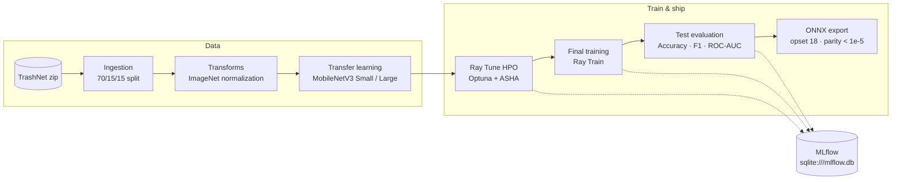
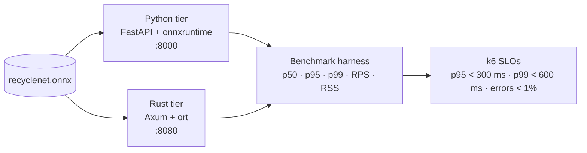
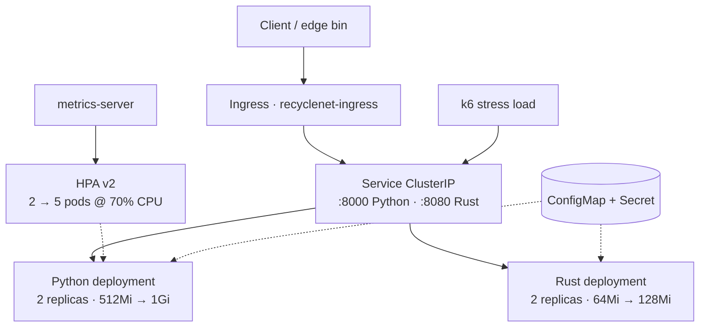
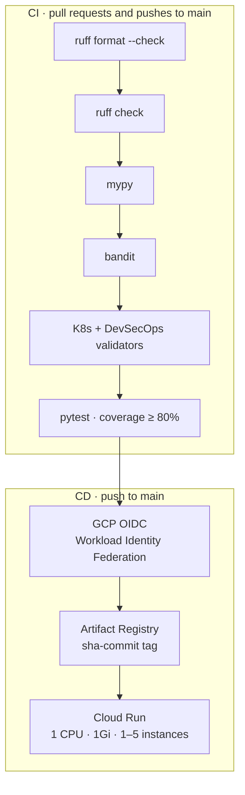

<div align="center">

# ♻️ RecycleNet-K8s

**Production-grade MLOps for waste classification — from distributed hyperparameter search to a Rust + ONNX edge runtime, orchestrated on Kubernetes.**

[](https://github.com/PilotLeoYan/RecycleNet-K8s/actions/workflows/ci.yaml) [](https://github.com/PilotLeoYan/RecycleNet-K8s/actions/workflows/cd.yaml) [](https://github.com/PilotLeoYan/RecycleNet-K8s/actions/workflows/codeql.yml) [](https://pilotleoyan.github.io/RecycleNet-K8s/)

[](https://www.python.org/) [](https://pytorch.org/) [](https://onnxruntime.ai/) [](https://kubernetes.io/) [](https://huggingface.co/LeoYan/recyclenet-mobilenetv3) [](https://opensource.org/licenses/MIT)

[Quickstart](#quickstart) · [Results](#results) · [Documentation](#documentation) · [🤗 Model Card](https://huggingface.co/LeoYan/recyclenet-mobilenetv3)

</div>

## Overview

RecycleNet classifies municipal waste into six streams — **cardboard, glass, metal, paper, plastic and trash** — with transfer learning on MobileNetV3 over the TrashNet dataset (2,527 images, 70/15/15 split).

The repository is a reproducible MLOps reference implementation: deterministic seeding, Ray Tune HPO with ASHA pruning, MLflow tracking, ONNX export with numerical-parity checks, dual Python/Rust inference tiers, hardened containers, a local Minikube HPA lab, and keyless CI/CD to Google Cloud Run.

| Phase | Scope | Core technologies | Status |
| :--- | :--- | :--- | :---: |
| **1 · Training** | Ingestion → HPO → training → ONNX export | PyTorch, Ray Train/Tune, Optuna, MLflow | ✅ |
| **2 · Inference** | Dual serving tiers + scientific benchmarking | FastAPI, ONNX Runtime, Rust (Axum + ort), k6 | ✅ |
| **3 · Kubernetes** | Declarative orchestration + local HPA lab | Minikube, Kustomize, HPA v2, probes | ✅ |
| **4 · DevSecOps** | Quality gates, SAST, keyless cloud delivery | GitHub Actions, CodeQL, GCP OIDC, Cloud Run | ✅ |

## Quickstart

```bash
git clone https://github.com/PilotLeoYan/RecycleNet-K8s.git
cd RecycleNet-K8s

make sync-cpu     # or: make sync-gpu
make super-train  # HPO → retrain best config → ONNX export
make mlflow       # UI at http://localhost:5000
```

**Prerequisites:** [uv](https://docs.astral.sh/uv/) and GNU Make. The training pipeline expects the TrashNet archive at `trashnet/dataset-original.zip` (configurable in `configs/config.yaml`). Docker, Rust, Minikube and k6 are only needed to run Phases 2 and 3.

---

## Phase 1 — Training, HPO & ONNX Export



### Usage

```bash
make train        # baseline run with configs/config.yaml
make hpo          # Ray Tune search → configs/best_hpo_config.yaml
make train-best   # retrain using the best HPO configuration
make export       # ONNX export + numerical parity check
make mlflow       # inspect runs, metrics and artifacts
```

Use `CONFIG=configs/smoke.yaml` for a 3-epoch CPU smoke run (e.g. `make train CONFIG=configs/smoke.yaml`) and `EXTRA_ARGS` to forward CLI flags. The ImageNet backbone stays frozen by default; only the 6-class head is optimized. HPO sweeps learning rate (1e-4–1e-2, log), weight decay (1e-4–1e-1, log) and batch size (16/32/64) across 20 trials, pruned with ASHA (grace 3, max 8 epochs); final training uses AdamW, a cosine schedule with warmup, and early stopping (patience 7).

---

## Phase 2 — Dual Inference & Benchmarking



### Usage

```bash
make api                                                         # Python tier on :8000
cargo run --release --manifest-path rust_inference/Cargo.toml    # Rust tier on :8080
uv run python benchmarks/benchmark_suite.py --requests 50        # latency, RSS and parity report
k6 run -e TARGET_URL=http://localhost:8000 benchmarks/k6_load_test.js
k6 run -e TARGET_URL=http://localhost:8080 benchmarks/k6_load_test.js
```

Both tiers load the artifact produced by `make export` in Phase 1. They expose the same contract: `GET /health`, `/healthz`, `/ready`, `/info` and `POST /predict` (multipart file or base64 image, with optional GPS telemetry). The Rust engine preprocesses with `image` + `ndarray` and loads the graph through `ort`, keeping outputs within `1e-5` of the PyTorch reference.

---

## Phase 3 — Kubernetes Orchestration & Local HPA Lab



### Usage

```bash
./scripts/k8s_local_lab.sh --dry-run all   # preview all 5 steps, no cluster required
./scripts/k8s_local_lab.sh all             # start → metrics → build → deploy → stress
./scripts/k8s_local_lab.sh status          # pods, services, HPA, resource usage

# Windows PowerShell
.\scripts\k8s_local_lab.ps1 -Action all
```

Or run the lab manually:

```bash
minikube start --driver=docker --cpus=4 --memory=4096
minikube addons enable metrics-server
eval $(minikube docker-env)
docker build -t recyclenet-api:local .
docker build -f Dockerfile.rust -t recyclenet-rust:local .
kubectl apply -k k8s/
kubectl get hpa recyclenet-hpa -w
```

Manifests enforce non-root execution (UID 10001), liveness/readiness probes, rolling updates, Burstable QoS and PodAntiAffinity. The HPA scales the Python deployment from 2 to 5 pods at 70% CPU, adding up to 100% (or 2 pods) every 15s and applying a 60s stabilization window before scaling down. Validate everything offline with:

```bash
uv run python -m src.k8s.orchestrator
```

---

## Phase 4 — DevSecOps & GCP Deployment



### Usage

```bash
make format       # ruff format
make lint         # ruff check + mypy
make test         # pytest with 80% coverage gate
make security     # bandit SAST
make check        # pre-commit across all files
make devsecops    # offline CI gates + OIDC + Cloud Run simulation
```

Workflows: `ci.yaml`, `cd.yaml`, `codeql.yml`, `dependency-review.yml`, `docs.yml` and `pr-validation.yml`. On `main`, `cd.yaml` authenticates to GCP with OIDC, pushes `sha-<commit>` to Artifact Registry and deploys Cloud Run. Without `GCP_PROJECT_ID`, `GCP_WORKLOAD_IDENTITY_PROVIDER` and `GCP_SERVICE_ACCOUNT_EMAIL` it runs in dry-run validation mode.

Supply-chain hardening is pinned via `[tool.uv] override-dependencies` and `uv.lock`:

| Package | Version | Remediation |
| :--- | :---: | :--- |
| `gitpython` | `>= 3.2.1` | High-severity RCE in submodule path validation |
| `graphql-core` | `>= 3.2.12` | High-severity DoS in the parser and validation |
| `opentelemetry-api` | `>= 1.45.1` | Moderate DoS via unbounded `tracestate` headers |
| `cryptography` | `>= 50.0.0` | Hardened OpenSSL bindings and X.509 primitives |

---

## Results

Held-out TrashNet test split (15%, 379 images), no data leakage:

| Metric | MobileNetV3-Small | MobileNetV3-Large | Δ (Large − Small) |
| :--- | ---: | ---: | ---: |
| Test accuracy | 78.10% | **83.11%** | +5.01 pp |
| Macro F1 | 74.91% | **80.51%** | +5.60 pp |
| ROC-AUC (OvR) | 0.9472 | **0.9790** | +0.0318 |
| Test loss | 0.6512 | **0.4879** | −0.1633 |
| Parameters | 1.52 M | 4.21 M | +2.69 M |
| ONNX size | 6.08 MB | 16.35 MB | +10.27 MB |
| PyTorch ↔ ONNX Δmax | 2.15e-6 | 5.72e-6 | within `1e-5` |

| Class | Support | Small F1 | Large F1 |
| :--- | :---: | :---: | :---: |
| Cardboard | 59 | 88.29% | 87.85% |
| Glass | 78 | 79.78% | 85.88% |
| Metal | 61 | 77.31% | 82.64% |
| Paper | 91 | 80.92% | 84.44% |
| Plastic | 66 | 74.24% | 81.75% |
| Trash | 24 | 48.89% | 60.47% |

### Model I/O contract

| Field | Specification |
| :--- | :--- |
| **Input** | `image` · `float32[batch, 3, 224, 224]` · RGB · ImageNet normalization (μ = 0.485/0.456/0.406, σ = 0.229/0.224/0.225) |
| **Output** | `logits` · `float32[batch, 6]` |
| **Classes** | `0` cardboard · `1` glass · `2` metal · `3` paper · `4` plastic · `5` trash |

🤗 Published weights: [LeoYan/recyclenet-mobilenetv3](https://huggingface.co/LeoYan/recyclenet-mobilenetv3) — `recyclenet-small.onnx` for embedded and edge targets, `recyclenet-large.onnx` for accuracy-critical cloud serving.

---

## Repository layout

```text
.github/workflows/   CI/CD, CodeQL, dependency review, docs, PR metadata validation
benchmarks/          k6 load test + Python dual-engine benchmark harness
configs/             config.yaml, smoke.yaml (+ generated best_hpo_config.yaml)
docs/                MkDocs Material documentation
k8s/                 Kustomize manifests: deployments, service, HPA, ingress, config
models/              Local ONNX artifacts and model card (git-ignored, published on HF)
rust_inference/      Axum + ort microservice
scripts/             k8s_local_lab.sh / k8s_local_lab.ps1 automation
src/api/             FastAPI inference tier
src/components/      ingestion, transforms, model, train step, metrics, evals, MLflow
src/config/          Pydantic settings schema
src/devsecops/       CI/CD and GCP OIDC / Cloud Run validator
src/k8s/             Manifest, QoS and HPA control-loop validator
src/pipeline/        train · hpo · export_onnx · super_train
src/utils/           logging, CLI parser, tracking helpers
tests/               pytest unit and integration suites
```

## Documentation

- [Architecture](docs/architecture.md)
- [Serving architecture](docs/serving_architecture.md)
- [Kubernetes orchestration](docs/k8s_orchestration.md)
- [DevSecOps & CI/CD](docs/devsecops_cicd.md)
- [API reference: components](docs/reference/components.md) · [pipelines](docs/reference/pipeline.md) · [utilities](docs/reference/utils.md)
- Rendered site: [pilotleoyan.github.io/RecycleNet-K8s](https://pilotleoyan.github.io/RecycleNet-K8s/)

## License & citation

Released under the **MIT License**. If you use RecycleNet in research, please cite:

```bibtex
@misc{recyclenet2026,
  author = {Ortega Rivera, Leonardo F.},
  title = {RecycleNet: Deep Learning & MLOps for Real-Time Waste Classification},
  year = {2026},
  publisher = {Hugging Face},
  url = {https://github.com/PilotLeoYan/RecycleNet-K8s}
}
```
