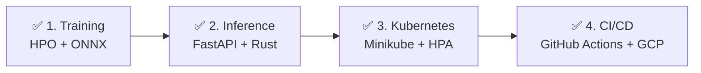
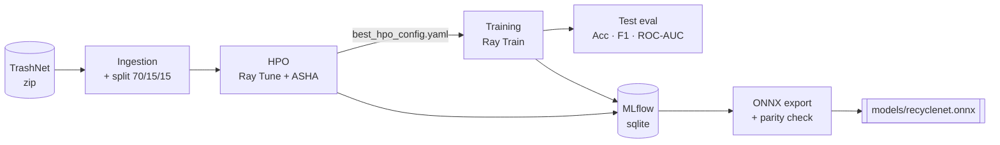
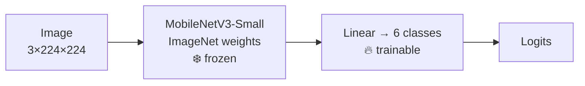
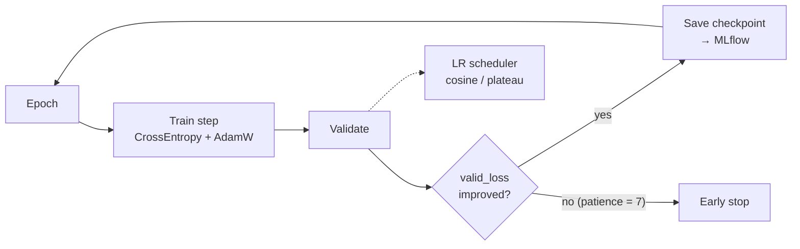
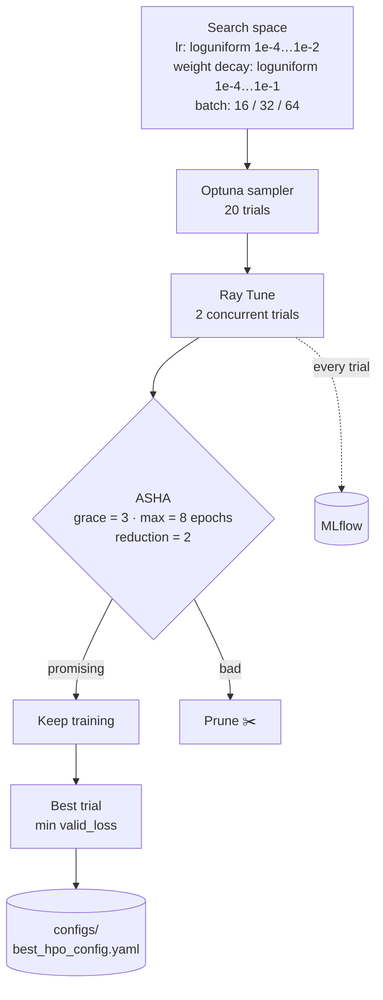
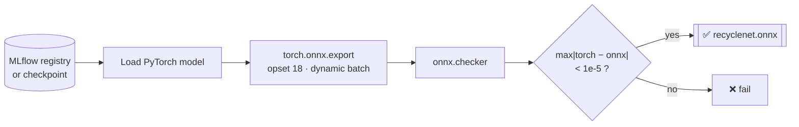
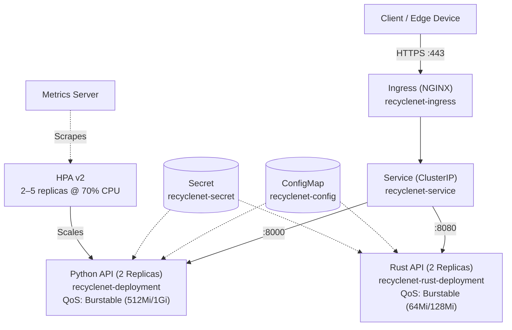
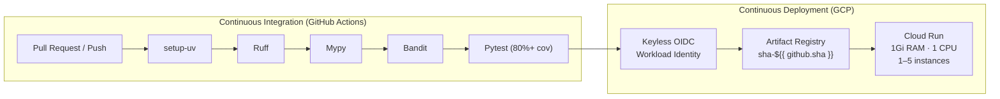

# ♻️ RecycleNet-K8s

Waste classification (TrashNet, 6 classes) with an end-to-end MLOps pipeline.

> **Status:** 🟢 Phase 1 (Training) & Phase 2 (Inference) done · 🟢 Phase 3 (Kubernetes) ready · 🟢 Phase 4 (CI/CD & GCP) done
>
> 🤗 **Model:** [LeoYan/recyclenet-mobilenetv3](https://huggingface.co/LeoYan/recyclenet-mobilenetv3)

## 🗺️ Roadmap



---

# 🟢 Phase 1: Training

## Overview



## Model



Transfer learning: only the last classifier layer is trained.

## Training loop



## Hyperparameter search (HPO)



## ONNX export



## Results

| Test accuracy | F1 (macro) | ROC-AUC (OvR) |
| :-: | :-: | :-: |
| 0.781 | 0.749 | 0.947 |

*Source: [`models/model_card.json`](models/model_card.json).*

🤗 **Trained model:** [LeoYan/recyclenet-mobilenetv3](https://huggingface.co/LeoYan/recyclenet-mobilenetv3)

---

# 🟢 Phase 3: Cloud-Native Kubernetes Orchestration & Local HPA Lab

Production-grade declarative orchestration with zero-trust container security, high availability, and dynamic horizontal pod autoscaling tested locally on Minikube with zero cloud cost.

## Manifest Architecture



## Minikube Local Lab Commands

Run the automated 5-step lab workflow using the cross-platform automation scripts:

```bash
# Linux / macOS / WSL2 / Git Bash:
./scripts/k8s_local_lab.sh --dry-run all   # Preview without cluster
./scripts/k8s_local_lab.sh all            # Execute complete 5-step lab

# Windows PowerShell:
.\scripts\k8s_local_lab.ps1 -DryRun -Action all
.\scripts\k8s_local_lab.ps1 -Action all
```

Or execute the 5 steps manually:

```bash
# 1. Start local cluster
minikube start --driver=docker --cpus=4 --memory=4096

# 2. Enable metrics server for HPA
minikube addons enable metrics-server

# 3. Build container images inside Minikube Docker daemon
eval $(minikube docker-env)
docker build -t recyclenet-api:local .
docker build -f Dockerfile.rust -t recyclenet-rust:local .

# 4. Deploy declarative manifests & await rollout
kubectl apply -k k8s/
kubectl rollout status deployment/recyclenet-deployment --timeout=120s
kubectl rollout status deployment/recyclenet-rust-deployment --timeout=120s

# 5. Live HPA Autoscaling stress test
kubectl port-forward svc/recyclenet-service 8000:8000 8080:8080 &
k6 run -e TARGET_URL=http://localhost:8000 benchmarks/k6_load_test.js
kubectl get hpa recyclenet-hpa -w
```

## Offline Simulation & Manifest Validation

Verify manifest schemas, Burstable QoS calculations, and HPA control loop dynamics without requiring Minikube or Docker:

```bash
uv run python -m src.k8s.orchestrator
```

---

# 🟢 Phase 4: Continuous DevSecOps & Cloud Deployment (GCP)

Automated zero-trust CI/CD pipeline enforcing 5 quality and security gates, keyless Google Cloud authentication via Workload Identity Federation (OIDC), immutable container publishing to Google Artifact Registry, and serverless auto-scaling on Google Cloud Run.

## Pipeline Architecture



## Supply Chain Security & CVE Version Patches

Transitive dependencies are hardened via `[tool.uv] override-dependencies` in `pyproject.toml` and locked in `uv.lock`, alongside CodeQL `CWE-020` URL/domain sanitization in OIDC claim verification:

| Package | Patched Version | Security Remediation |
| :--- | :---: | :--- |
| `gitpython` | `3.1.62` → **`3.2.1`** | Fixes **High** RCE in submodule `.git` path validation prior to cloning |
| `graphql-core` | `3.2.11` → **`3.2.13`** | Fixes two **High** DoS vulnerabilities in `max_tokens` parser & field validation |
| `opentelemetry-api` | `1.44.0` → **`1.45.1`** | Fixes **Moderate** DoS in unbounded `tracestate` header parsing (`sdk` & `proto` synced) |
| `cryptography` | **`>= 50.0.0`** | Enforces hardened OpenSSL bindings and X.509 primitives |

## Offline Verification & DevSecOps CLI

Verify CI quality gates, OIDC token claims exchange, and Cloud Run scaling rules offline:

```bash
uv run python -m src.devsecops.orchestrator
```

---

## Quickstart

```bash
make sync-cpu          # or: make sync-gpu
make super-train       # HPO → train (best config) → ONNX export
make mlflow            # UI at http://localhost:5000
```

Or step by step:

| Command | What it does |
| :-- | :-- |
| `make train` | Train with `configs/config.yaml` |
| `make hpo` | Ray Tune search → writes `configs/best_hpo_config.yaml` |
| `make train-best` | Train using the best HPO config |
| `make export` | Export to `models/recyclenet.onnx` |
| `make test` · `make lint` | pytest · ruff + mypy |

## Layout

```text
.github/workflows/   CI/CD pipelines (ci.yaml, cd.yaml, codeql, dependency-review)
configs/             YAML configs (config, smoke, best_hpo)
k8s/                 Declarative manifests (Deployments, Service, HPA, Ingress, ConfigMap, Secret)
rust_inference/      High-performance Rust microservice (Axum + ort)
scripts/             Local lab automation scripts (k8s_local_lab.sh, k8s_local_lab.ps1)
src/api/             FastAPI baseline inference microservice
src/components/      data, model, train step, metrics, evals, MLflow logging
src/devsecops/       DevSecOps CI/CD validator, GCP OIDC & Cloud Run simulator
src/k8s/             Kubernetes declarative validation & HPA simulation engine
src/pipeline/        train · hpo · export_onnx · super_train
src/main.py          CLI (train | hpo | export | super-train)
models/              ONNX model + model card
tests/               unit & integration tests
```

## Stack

PyTorch · Ray Train/Tune · Optuna · MLflow · ONNX Runtime · Rust (Axum) · Kubernetes (Minikube + HPA v2) · GitHub Actions · GCP (OIDC + Artifact Registry + Cloud Run) · uv · ruff · mypy · bandit · pytest
