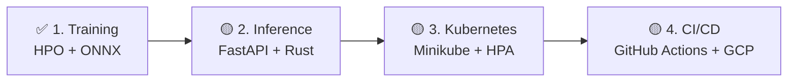
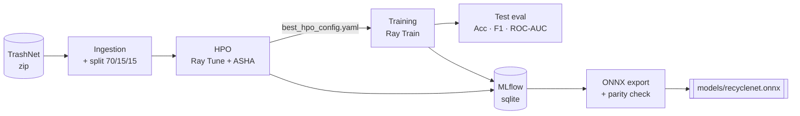
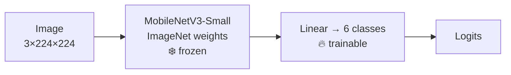
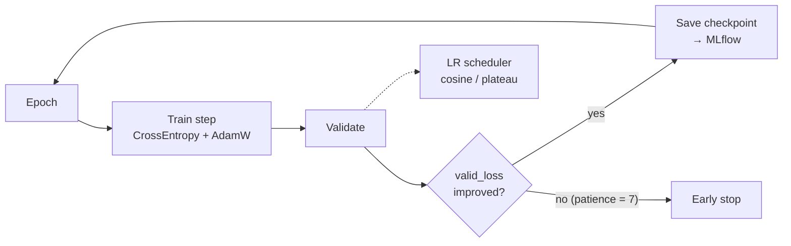
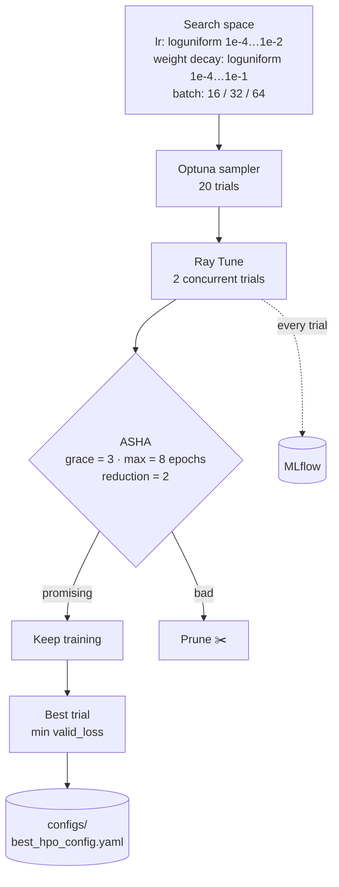
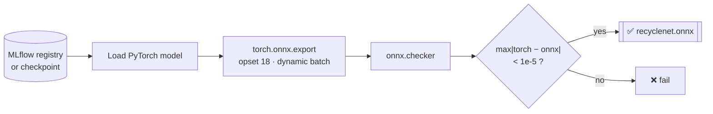

# ♻️ RecycleNet-K8s

Waste classification (TrashNet, 6 classes) with an end-to-end MLOps pipeline.

> **Status:** 🟢 Phase 1 (Training) done · 🟡 Phase 2–4 (Inference, Kubernetes, CI/CD) in progress

## 🗺️ Roadmap



---

# 🟢 Phase 1: Training

## Overview



## Model



Transfer learning: only the last classifier layer is trained.

## Training loop



## Hyperparameter search (HPO)



## ONNX export



## Results

| Test accuracy | F1 (macro) | ROC-AUC (OvR) |
| :-: | :-: | :-: |
| 0.781 | 0.749 | 0.947 |

*Source: [`models/model_card.json`](models/model_card.json).*

## Quickstart

```bash
make sync-cpu          # or: make sync-gpu
make super-train       # HPO → train (best config) → ONNX export
make mlflow            # UI at http://localhost:5000
```

Or step by step:

| Command | What it does |
| :-- | :-- |
| `make train` | Train with `configs/config.yaml` |
| `make hpo` | Ray Tune search → writes `configs/best_hpo_config.yaml` |
| `make train-best` | Train using the best HPO config |
| `make export` | Export to `models/recyclenet.onnx` |
| `make test` · `make lint` | pytest · ruff + mypy |

## Layout

```text
configs/             YAML configs (config, smoke, best_hpo)
src/components/      data, model, train step, metrics, evals, MLflow logging
src/pipeline/        train · hpo · export_onnx · super_train
src/main.py          CLI (train | hpo | export | super-train)
models/              ONNX model + model card
tests/               unit tests
```

## Stack

PyTorch · Ray Train/Tune · Optuna · MLflow · ONNX Runtime · uv · ruff · mypy · pytest
