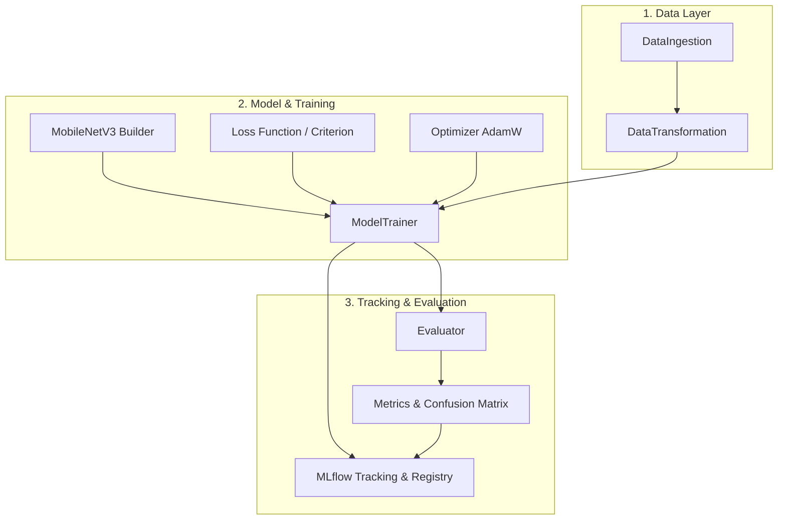

# Architecture & MLOps Lifecycle

RecycleNet follows a four-phase MLOps roadmap designed for robust, reproducible, and scalable production deployments.

---

## 🏗️ Architecture Overview

---

## 📐 SOLID Principles in RecycleNet

| Principle | Implementation in RecycleNet |
| :--- | :--- |
| **S - Single Responsibility** | Components are decoupled: `DataIngestion` extracts datasets, `DataTransformation` generates tensor pipelines, `ModelTrainer` executes optimization loops, and `LogModel` interacts with MLflow. |
| **O - Open/Closed** | Training pipelines and architectures are extensible without modifying existing orchestration logic. |
| **L - Liskov Substitution** | Custom dataset transformations and model wrappers seamlessly adhere to standard PyTorch interfaces (`Dataset`, `DataLoader`, `nn.Module`). |
| **I - Interface Segregation** | Fine-grained interfaces for metric calculation, data loading, and tracking rather than monolithic classes. |
| **D - Dependency Inversion** | High-level orchestrators (`TrainPipeline`) receive configurations and abstractions via dependency injection rather than hardcoded global values. |

---

## 🗺️ Project Roadmap Phases

| Phase | Focus Area | Key Technologies | Status |
| :--- | :--- | :--- | :--- |
| **Phase 1** | Distributed Training & HPO | PyTorch, Ray Tune, Optuna, MLflow, ONNX | ✅ Completed |
| **Phase 2** | Dual Inference Architecture | FastAPI, Rust Axum, ONNX Runtime, k6 | ✅ Completed |
| **Phase 3** | Cloud-Native Orchestration | Kubernetes, Minikube, HPA v2, Zero-Trust | ✅ Completed |
| **Phase 4** | Continuous DevSecOps & GCP | GitHub Actions, uv, Bandit, OIDC, Cloud Run | ✅ Completed |

### Detailed Phase Specifications

1. **Phase 1: Local Training & MLflow Tracking (Completed ✅)**
   * Transfer Learning on MobileNetV3-Small with frozen backbone.
   * Reproducible DataLoaders with deterministic seeding across backends.
   * Ray Tune + ASHA hyperparameter search writing `best_hpo_config.yaml`.
   * SQLite-backed MLflow experiment tracking and ONNX model parity verification.

2. **Phase 2: Dual Inference & Containerization (Completed ✅)**
   * Low-latency Python FastAPI baseline microservice.
   * High-performance compiled Rust Axum microservice leveraging `ort`.
   * Numerical parity verification and k6 load testing benchmarks.
   * Multi-stage unprivileged Dockerfiles with `uv` and `cargo-chef`.

3. **Phase 3: Testing & Kubernetes Orchestration (Completed ✅)**
   * Pytest unit and integration test suite with high coverage.
   * Declarative Kubernetes manifests with zero-trust security (`runAsNonRoot: true`, `drop: [ALL]`).
   * Burstable QoS resource quotas and closed-loop HPA v2 autoscaling.
   * Local Minikube automated 5-step lab runbook with zero cloud cost.

4. **Phase 4: Continuous DevSecOps & GCP Cloud Deployment (Completed ✅)**
   * GitHub Actions CI pipeline with 5 quality and security gates (`ruff`, `mypy`, `bandit`, `pytest`).
   * Keyless Google Cloud authentication using Workload Identity Federation (OIDC).
   * Immutable container publishing to Google Artifact Registry (`sha-${{ github.sha }}`).
   * Serverless deployment to Google Cloud Run with warm instances and concurrency limits.
