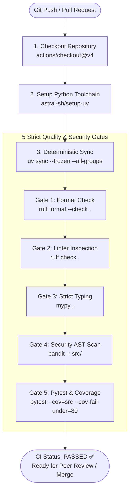
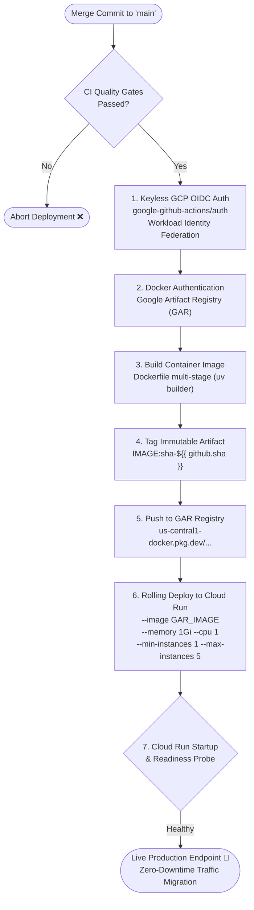
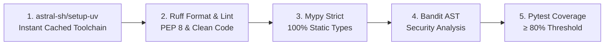
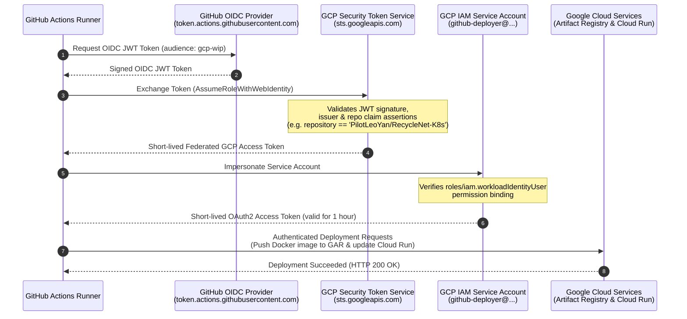

# 🛡️ Continuous DevSecOps & GCP Cloud Deployment

## 1. Executive Summary & DevSecOps Philosophy

In enterprise MLOps architectures, developing high-performing computer vision models and local containerized endpoints represents only the first milestone of the product lifecycle. To achieve reliable production maturity, systems must embed **DevSecOps** practices—shifting quality assurance, security auditing, and cloud governance left into automated pipelines.

**RecycleNet-K8s Phase 4** establishes an automated, zero-trust Continuous Integration and Continuous Deployment (CI/CD) foundation targeting **Google Cloud Platform (GCP)**. The architecture guarantees:

- **Automated Quality & Security Gates:** Every pull request is verified against strict code formatting, comprehensive type checking, AST-based security vulnerability analysis, and enforced test coverage thresholds.
- **Keyless Cloud Authentication:** Zero static JSON service account keys. Authentication between GitHub Actions and GCP is handled entirely through short-lived cryptographic tokens via **OpenID Connect (OIDC)** and **Workload Identity Federation**.
- **Immutable Container Artifacts:** Container builds are uniquely and immutably tagged with commit SHA identifiers (`sha-${{ github.sha }}`) in **Google Artifact Registry (GAR)**, eliminating configuration drift and enabling deterministic rollbacks.
- **Serverless Cloud Run Deployment:** Production inference workloads deploy serverlessly to **Google Cloud Run** with managed TLS, granular resource limits (`1Gi` RAM, `1` CPU), and dynamic auto-scaling from 1 warm instance up to 5 instances under load.
- **Local Simulation & Offline Verification:** A dedicated orchestration CLI validates workflow schemas, security constraints, and deployment scenarios offline without incurring cloud egress costs.

---

## 2. End-to-End DevSecOps Architecture & Pipeline Topology

The continuous lifecycle is split into two specialized GitHub Actions workflows:

1. **Continuous Integration (`.github/workflows/ci.yaml` / `ci.yml`):** Runs on every pull request and push to `main` to validate quality, security, and functional correctness.
2. **Continuous Deployment (`.github/workflows/cd.yaml`):** Runs automatically upon merging to `main`, executing keyless GCP federation, container compilation, image registry push, and Cloud Run service rollout.

### CI Pipeline Workflow



### CD Pipeline Workflow



---

## 3. The 5 CI Quality & Security Gates in Detail

To ensure code stability, prevent regression, and enforce clean architecture, the CI pipeline executes five sequential verification gates:



### Gate 1: Astral-sh Setup-uv (`astral-sh/setup-uv`)
- **Role:** High-performance dependency resolution and virtual environment bootstrapping.
- **Mechanism:** Powered by Rust, `uv` installs and synchronizes dependencies in milliseconds. The workflow caches wheel artifacts using `cache-dependency-glob: "uv.lock"`.
- **Command:**
  ```bash
  uv sync --frozen --all-groups --extra cpu
  ```
- **Benefit:** Guarantees bitwise reproducibility across local development workstations and remote GitHub Actions runners.

### Gate 2: Ruff Code Formatting & Linting (`ruff`)
- **Role:** Comprehensive syntax verification, import classification, and PEP 8 formatting.
- **Configuration:** Adheres to strict 88-character line length (`line-length = 88`), Py314 target conventions, and import sorting (`select = ["E", "F", "I", "W", "UP"]`).
- **Commands:**
  ```bash
  uv run ruff format --check .
  uv run ruff check .
  ```
- **Benefit:** Eliminates stylistic discrepancies and enforces idiomatic Python patterns before code review.

### Gate 3: Mypy Strict Static Type Verification (`mypy`)
- **Role:** Compile-time validation of types across domain models, configuration schemas, and pipeline components.
- **Configuration:** Flags untyped function definitions (`disallow_untyped_defs = true`), warns on unreachable branches (`warn_unreachable = true`), and prohibits arbitrary dynamic typing.
- **Command:**
  ```bash
  uv run mypy .
  ```
- **Benefit:** Prevents insidious runtime crashes such as `AttributeError` or `TypeError` before code reaches containerization.

### Gate 4: Bandit AST Security Analysis (`bandit`)
- **Role:** Static Application Security Testing (SAST) analyzing Python Abstract Syntax Trees (AST).
- **Configuration:** Defined in `pyproject.toml`, scanning `src/` while ignoring false-positive assertion checks (`B101`) and pseudo-random generators in non-cryptographic ML trials (`B311`).
- **Command:**
  ```bash
  uv run bandit -r src/ -c pyproject.toml
  ```
- **Benefit:** Proactively discovers high-risk vulnerabilities including hardcoded secrets, shell injection vulnerabilities, unsafe deserialization, and improper socket bindings.

### Gate 5: Pytest Unit & Integration Coverage (`pytest-cov`)
- **Role:** Functional correctness verification across data ingestion, model building, ONNX export, REST API endpoints, and Kubernetes orchestration logic.
- **Enforcement:** Enforces an explicit 80%+ coverage threshold (`fail_under = 80`). If test coverage drops below 80%, the CI pipeline immediately fails, blocking PR merge.
- **Command:**
  ```bash
  uv run pytest tests/ -v --durations=10 --cov=src --cov-fail-under=80
  ```
- **Benefit:** Assures that all critical algorithmic logic, edge-case exception handling, and API serialization paths are validated against regressions.

---

## 4. Keyless Workload Identity Federation (GitHub Actions ↔ GCP OIDC)

Traditional CI/CD setups rely on long-lived Service Account JSON keys stored in repository secrets. This represents a significant security liability:
- Keys do not automatically expire.
- Keys are susceptible to leakage or insider exfiltration.
- Secret rotation requires manual effort and risk of downtime.

RecycleNet adopts **OpenID Connect (OIDC)** and **Google Cloud Workload Identity Federation**, establishing a cryptographic trust exchange between GitHub's OIDC Provider and GCP Security Token Service (STS).

### Keyless Token Exchange Sequence



### GitHub Actions OIDC Configuration

In `.github/workflows/cd.yaml`, permissions require `id-token: write` to issue OIDC credentials:

```yaml
permissions:
  contents: read
  id-token: write

steps:
  - name: Authenticate to Google Cloud via OIDC
    uses: google-github-actions/auth@v2
    with:
      workload_identity_provider: "projects/1234567890/locations/global/workloadIdentityPools/github-actions-pool/providers/github-provider"
      service_account: "github-deployer@recyclenet-prod.iam.gserviceaccount.com"
      token_format: "access_token"
```

---

## 5. Immutable Container Versioning with Google Artifact Registry (GAR)

To maintain a secure software supply chain, all container artifacts produced by the CD pipeline are published to **Google Artifact Registry (GAR)**.

### Tagging Convention & Traceability

Using mutable tags such as `:latest` in production environments introduces substantial risk:
- It obscures which Git commit generated the running image.
- Rollbacks are non-deterministic because the tag points to different image digests over time.
- Multi-container clusters may run heterogeneous revisions under the same tag.

RecycleNet enforces **immutable commit SHA tagging**:

$$\text{Image Identifier} = \text{GAR\_LOCATION-docker.pkg.dev/PROJECT\_ID/REPOSITORY/recyclenet-api:sha-}\$\{ \text{GITHUB\_SHA} \}$$

```bash
# Tagging with full Git commit SHA
docker build -t us-central1-docker.pkg.dev/recyclenet-prod/recyclenet-registry/recyclenet-api:sha-${{ github.sha }} .
docker push us-central1-docker.pkg.dev/recyclenet-prod/recyclenet-registry/recyclenet-api:sha-${{ github.sha }}
```

Every deployed container image can be audited directly back to its exact Git commit, author, test logs, and PR approval.

---

## 6. Serverless Deployment: Google Cloud Run vs GKE

RecycleNet supports dual production deployment targets: **Google Cloud Run** (managed serverless) and **Google Kubernetes Engine (GKE)** (declarative cluster).

### Comparative Architecture Analysis

| Architectural Criterion | Google Cloud Run (Serverless) | Google Kubernetes Engine (GKE) |
| :--- | :--- | :--- |
| **Compute Paradigm** | Managed serverless container execution | Managed Kubernetes cluster (nodes/pods) |
| **Operational Overhead** | Near zero (no nodes, OS updates, or control plane) | Moderate to high (cluster upgrades, daemonsets, CNI) |
| **Autoscaling Mechanics** | Sub-second request-driven container scaling | HPA + Cluster Autoscaler (node provisioning latency) |
| **Idle Cost** | Zero (scales to zero when traffic stops) | Fixed baseline costs for control plane and node pool |
| **Ingress & Networking** | Managed HTTPS, automatic TLS certificates, DDoS mitigation | Requires Ingress controller (NGINX), Cert-Manager, DNS |
| **Ideal Workload Profile** | REST inference APIs, intermittent or spiky demand | High-throughput distributed pipelines, GPU training |

### Cloud Run Production Deployment Parameters

For Phase 4 serverless inference, the CD pipeline deploys the container with strict resource boundaries:

```bash
gcloud run deploy recyclenet-api \
  --image="us-central1-docker.pkg.dev/recyclenet-prod/recyclenet-registry/recyclenet-api:sha-${{ github.sha }}" \
  --region="us-central1" \
  --platform="managed" \
  --port=8000 \
  --memory=1Gi \
  --cpu=1 \
  --min-instances=1 \
  --max-instances=5 \
  --concurrency=80 \
  --allow-unauthenticated
```

### Parameter Rationale:
- `--port=8000`: Matches the internal FastAPI port exposed in the multi-stage Dockerfile.
- `--memory=1Gi`: Provides ample headroom for loading ONNX Runtime CPU inference engines and PyTorch image transforms without triggering out-of-memory errors.
- `--cpu=1`: Allocates a dedicated virtual CPU core, providing deterministic request latency.
- `--min-instances=1`: Keeps one warm instance active 24/7 to completely eliminate cold-start latency for interactive users.
- `--max-instances=5`: Sets a strict upper boundary to prevent runaway cloud bills during unexpected denial-of-service or load spikes.
- `--concurrency=80`: Allows up to 80 simultaneous requests per container instance before provisioning additional replicas.

---

## 7. Offline DevSecOps Validation & Simulation CLI

To facilitate verification of DevSecOps pipelines and deployment specifications on air-gapped development machines without active GCP access, RecycleNet provides an offline simulation CLI:

```bash
uv run python -m src.devsecops.orchestrator
```

### Available CLI Options

```text
Options:
  --help          Show help message and exit
  --ci-only       Execute only CI quality gate rule validation
  --cd-only       Execute only CD GCP OIDC and deployment rule validation
  --format-md     Export execution summary as GitHub Flavored Markdown
```

### Verification Capabilities
- **Static Workflow Linting:** Parses `.github/workflows/ci.yaml` and `.github/workflows/cd.yaml` to ensure all 5 quality gates and OIDC actions are configured correctly.
- **OIDC Claims Simulation:** Simulates the STS cryptographic token exchange, verifying subject claim restrictions (`repo:PilotLeoYan/RecycleNet-K8s:ref:refs/heads/main`).
- **Cloud Run Scaling Trajectory:** Computes instance scaling trajectories across simulated request traffic patterns, verifying min/max boundaries and concurrency quotas.
