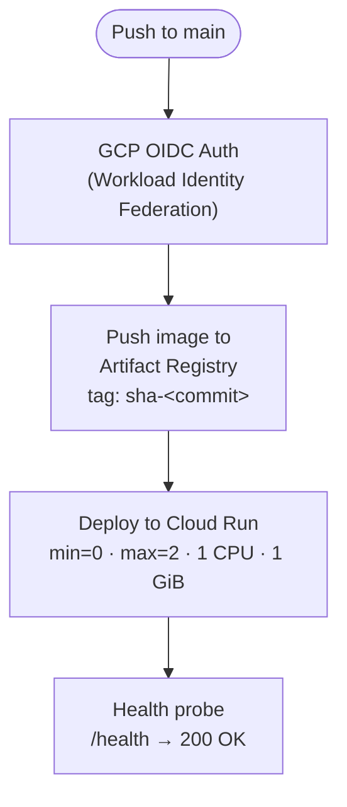

# 🚀 GCP Cloud Run Deployment Guide — Zero-Cost Serverless Inference

This guide explains how to deploy the **RecycleNet-K8s** inference service on
**Google Cloud Run** with a **$0.00 zero-cost profile**, ideal for live demos,
technical evaluations, and staging environments.

---

## 1. 🧭 Architecture & Zero-Cost Philosophy

### 🎯 1.1. What is Google Cloud Run?

Google Cloud Run is a **serverless**, fully managed container platform from
Google Cloud. Unlike traditional Kubernetes clusters (GKE) or virtual machines
(Compute Engine) that charge by the hour regardless of traffic, Cloud Run bills
**exclusively for CPU and memory consumed while actively processing HTTP
requests**.

### 💡 1.2. Why Cloud Run instead of GKE for a demo?

1. **Per-millisecond billing:** When no requests arrive the container scales
   down to zero — idle cost = **$0.00**.
2. **GCP permanent free tier (monthly):**
   - **2,000,000 HTTP requests** free.
   - **360,000 GB-seconds** of memory free.
   - **180,000 vCPU-seconds** of compute free.
   - **1 GiB outbound traffic** to North America free.
3. **Real demo consumption** (~3–10 users, one inference each):
   - Average inference time: $\approx 250\,\text{ms}$.
   - Total vCPU usage: $10 \times 0.25\,\text{s} = 2.5\,\text{vCPU-s}$
     (of 180,000 free).
   - Total RAM usage: $10 \times 0.25\,\text{s} = 2.5\,\text{GB-s}$
     (of 360,000 free).
   - **Effective charge: $0.00 USD.**

### 🛡️ 1.3. The Two Wallet-Protection Flags

Every deployment enforces:

| Flag | Value | Effect |
| :--- | :--- | :--- |
| `--min-instances` | `0` | Scale-to-zero when idle; no charge at rest. |
| `--max-instances` | `2` | Hard cap; prevents runaway billing spikes. |

---

## 2. 📋 GCP Project Configuration Reference

| Parameter | Value |
| :--- | :--- |
| **Project Name** | `RecycleNet-K8s` |
| **Project ID** | `recyclenet-k8s` |
| **Recommended Region** | `us-central1` (full free tier) |
| **Cloud Run Service** | `recyclenet-service` |
| **Artifact Registry** | `recyclenet-images` |
| **Application Port** | `8000` (FastAPI / Uvicorn ASGI) |

> [!NOTE]
> The live service URL takes the form
> `https://recyclenet-service-<hash>-uc.a.run.app` and is printed at the end
> of the deploy script. It changes whenever the Cloud Run service is deleted
> and re-created.

---

## 3. 🛠️ Quick Automated Deployment (One Command)

The repository ships a fully automated script at `scripts/deploy_gcp.sh`.

### Step 1 — Authenticate `gcloud`

```bash
gcloud auth login
```

A browser window will open to complete Google account authorisation.

### Step 2 — Run the deployment

```bash
./scripts/deploy_gcp.sh
# or
make deploy-gcp
```

The script automatically:

1. Resolves `gcloud` and `docker-credential-gcloud` in `PATH`.
2. Verifies the active authenticated account.
3. Sets the active project (`recyclenet-k8s`).
4. Enables `run.googleapis.com` and `artifactregistry.googleapis.com`.
5. Creates the `recyclenet-images` Docker repository in Artifact Registry.
6. Configures the Docker credential helper for the regional registry.
7. Builds (or reuses) the local `recyclenet-api:demo` image.
8. Tags and pushes the image to Artifact Registry.
9. Deploys to Cloud Run with `--min-instances=0` and `--allow-unauthenticated`.
10. Verifies the live `/health` endpoint and prints the public URL.

> [!IMPORTANT]
> On a first run, Step 3 waits a few seconds after enabling the Artifact
> Registry API for GCP IAM propagation before querying the API. The script
> handles this automatically with `--quiet` flags and does **not** block
> indefinitely.

---

## 4. 🔬 Manual Step-by-Step Deployment

If you want to understand or reproduce every command individually:

### Step 1 — Set the active project

```bash
gcloud config set project recyclenet-k8s
```

### Step 2 — Enable required GCP APIs

```bash
gcloud services enable run.googleapis.com artifactregistry.googleapis.com
```

### Step 3 — Create the Artifact Registry Docker repository

```bash
gcloud artifacts repositories create recyclenet-images \
    --repository-format=docker \
    --location=us-central1 \
    --description="RecycleNet Docker container images"
```

### Step 4 — Configure Docker authentication

```bash
gcloud auth configure-docker us-central1-docker.pkg.dev --quiet
```

### Step 5 — Build and tag the Docker image

```bash
docker build -t recyclenet-api:demo .

docker tag recyclenet-api:demo \
    us-central1-docker.pkg.dev/recyclenet-k8s/recyclenet-images/recyclenet-api:demo
```

### Step 6 — Push to Artifact Registry

```bash
docker push us-central1-docker.pkg.dev/recyclenet-k8s/recyclenet-images/recyclenet-api:demo
```

### Step 7 — Deploy to Cloud Run (zero-cost constraints)

```bash
gcloud run deploy recyclenet-service \
    --image="us-central1-docker.pkg.dev/recyclenet-k8s/recyclenet-images/recyclenet-api:demo" \
    --region="us-central1" \
    --platform="managed" \
    --port=8000 \
    --memory=1Gi \
    --cpu=1 \
    --min-instances=0 \
    --max-instances=2 \
    --concurrency=80 \
    --allow-unauthenticated
```

At completion, `gcloud` prints the public HTTPS URL.

---

## 5. 🧪 Using the Live API

### 🌐 Option A — Swagger UI (recommended for demos)

Open in any browser:

```text
https://<YOUR-SERVICE-URL>/docs
```

1. Expand `POST /predict/`.
2. Click **"Try it out"**.
3. Upload a waste photo (cardboard, glass, metal, paper, plastic, or trash).
4. Click **"Execute"**.
5. Read the JSON response with predicted class, confidence, and class
   probabilities.

### 💻 Option B — `curl` from the terminal

```bash
curl -X POST "https://<YOUR-SERVICE-URL>/predict/" \
     -F "file=@path/to/waste_image.jpg"
```

Typical JSON response:

```json
{
  "predicted_class": "cardboard",
  "confidence": 0.9412,
  "class_probabilities": {
    "cardboard": 0.9412,
    "glass":     0.0121,
    "metal":     0.0094,
    "paper":     0.0210,
    "plastic":   0.0142,
    "trash":     0.0021
  },
  "telemetry": null
}
```

### 🩺 Option C — Health and readiness probes

| Endpoint | Purpose |
| :--- | :--- |
| `GET /healthz` | Kubernetes liveness probe (always 200 if process is up) |
| `GET /ready` | Kubernetes readiness probe (200 when model is loaded) |
| `GET /health` | General health status + `model_ready` flag |
| `GET /info` | Model metadata (name, version, classes) |

---

## 6. 🗑️ Post-Demo Teardown

After the presentation, delete all cloud resources to ensure zero residual
storage charges:

```bash
./scripts/teardown_gcp.sh
# or
make teardown-gcp
```

This deletes the Cloud Run service and the Artifact Registry repository,
leaving the GCP project at **$0.00 ongoing cost**.

---

## 7. 🔁 CI/CD Automated Deployment (GitHub Actions)

The `.github/workflows/cd.yaml` workflow runs automatically on
every push to `main` (when GCP OIDC secrets are configured) and mirrors the
manual steps above:



Required GitHub repository secrets and variables:

| Name | Type | Description |
| :--- | :--- | :--- |
| `GCP_PROJECT_ID` | Secret | GCP project ID string |
| `GCP_WORKLOAD_IDENTITY_PROVIDER` | Secret | Full WIF provider resource name |
| `GCP_SERVICE_ACCOUNT_EMAIL` | Secret | Deployer service account e-mail |
| `GCP_REGION` | Variable | Region (default: `us-central1`) |

Without these secrets the CD job runs in **dry-run mode** and prints a
simulation notice — no cloud resources are created.
