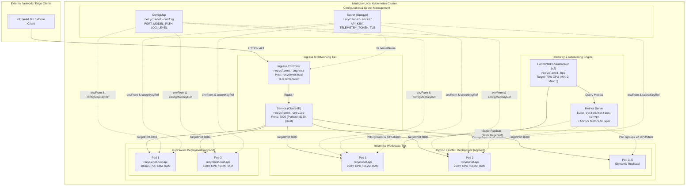
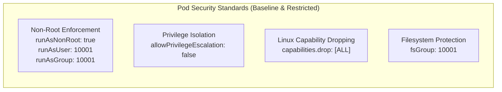
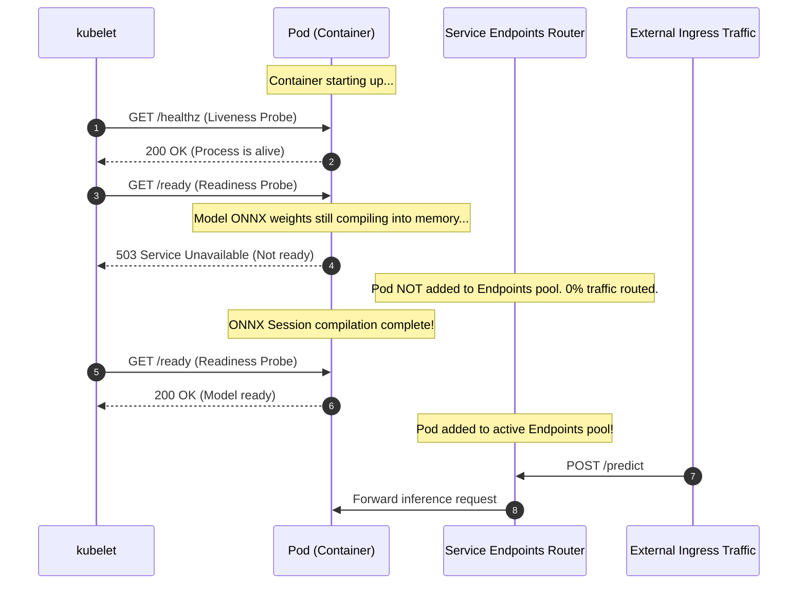
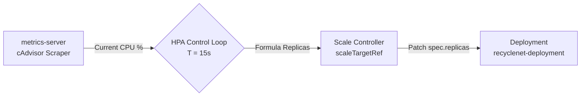

# ☸️ RecycleNet-K8s: Cloud-Native Orchestration with Local Kubernetes

## 1. Executive Summary & Orchestration Philosophy

In modern production Machine Learning systems, delivering high inference performance on a single machine is only half the battle. Real-world systems must guarantee **high availability (HA)**, **fault tolerance**, **predictable latency under burst load**, and **zero-downtime rolling updates**.

Derived from Google's internal cluster management system (**Borg**), **Kubernetes (K8s)** has emerged as the global standard for cloud-native workload orchestration. **RecycleNet-K8s** designs and validates a complete, production-grade Kubernetes deployment architecture that can be executed **locally with zero cloud costs** using [Minikube](https://minikube.sigs.k8s.io/) or [Kind](https://kind.sigs.k8s.io/).

### Key Engineering Objectives

- **High Availability & Redundancy:** Decoupled multi-tier deployment (Python FastAPI baseline and Rust Axum high-performance edge tier) running at a baseline of 2 replicas each with Pod Anti-Affinity.
- **Zero-Trust Security:** Containers execute under unprivileged non-root users (`appuser`, UID 10001), drop all Linux kernel capabilities (`drop: [ALL]`), and prohibit privilege escalation.
- **Resource Governance & QoS:** Rigorous CPU and Memory requests and limits configured to guarantee a **Burstable** Quality of Service (QoS) class, preventing catastrophic `OOMKilled` (Exit Code 137) crashes.
- **Deterministic Traffic Gating:** Decoupled Liveness (`/healthz`) and Readiness (`/ready`) probes ensure traffic is never routed to uninitialized model weights, while zero-downtime rolling updates (`maxSurge: 1, maxUnavailable: 0`) guarantee uninterrupted service.
- **Dynamic Autoscaling (HPA v2):** Closed-loop Horizontal Pod Autoscaler targeting 70% CPU utilization, scaling from 2 to 5 replicas with aggressive scale-up burst absorption and conservative cooldown stabilization against pod thrashing.

---

## 2. Declarative Architecture & Cluster Topology

The RecycleNet Kubernetes infrastructure adopts a declarative, GitOps-ready layout organized under `k8s/`.



### Declarative Manifest Inventory

| Manifest File | API Version & Kind | Primary Role & Governance |
| :--- | :--- | :--- |
| `k8s/kustomization.yaml` | `kustomize.config.k8s.io/v1beta1` | Root deployment order orchestration: Config -> Workloads -> Networking -> Autoscaler. |
| `k8s/configmap.yaml` | `v1/ConfigMap` | Non-sensitive runtime variables: ports (`8000`, `8080`), ONNX model path, logging levels. |
| `k8s/secret.yaml` | `v1/Secret` | Base64-encoded authentication tokens, telemetry shared keys, and self-signed TLS certs. |
| `k8s/deployment.yaml` | `apps/v1/Deployment` | Baseline Python FastAPI workload (2 replicas, non-root UID 10001, Burstable QoS, probes). |
| `k8s/deployment-rust.yaml` | `apps/v1/Deployment` | High-performance Rust edge workload (2 replicas, 64Mi requests, sub-millisecond execution). |
| `k8s/service.yaml` | `v1/Service` | Internal `ClusterIP` virtual IP router exposing port `8000` (Python) and port `8080` (Rust). |
| `k8s/hpa.yaml` | `autoscaling/v2/HorizontalPodAutoscaler` | Dynamic closed-loop autoscaler scaling Python replicas from 2 to 5 based on 70% CPU. |
| `k8s/ingress.yaml` | `networking.k8s.io/v1/Ingress` | NGINX-based layer-7 reverse proxy with TLS termination and upload size buffers (20m). |

---

## 3. Multi-Stage Zero-Trust Containerization

To minimize image bloat, eliminate build tools from runtime environments, and eliminate Common Vulnerabilities and Exposures (CVEs), both Python and Rust tiers utilize multi-stage Docker builds.

### Python Container Architecture (`Dockerfile`)
- **Stage 1 (Builder):** Uses `python:3.14-slim-bookworm` with Astral `uv` copied from `ghcr.io/astral-sh/uv:latest`. Compiles deterministic dependencies with bytecode compilation (`UV_COMPILE_BYTECODE=1`) and cache mounts (`--mount=type=cache,target=/root/.cache/uv`), downloading the MobileNetV3 ONNX model weights directly from Hugging Face.
- **Stage 2 (Runtime):** Minimal `python:3.14-slim-bookworm` runtime containing only the compiled virtual environment (`/app/.venv`) and model artifacts.

### Rust Container Architecture (`Dockerfile.rust`)
- **Stage 1 (Builder):** Uses `rust:1.85-slim-bookworm`, downloads the Microsoft ONNX Runtime C dynamic shared library (`libonnxruntime.so.1.20.1`), compiles the optimized release binary via `cargo build --release`, and downloads ONNX weights.
- **Stage 2 (Runtime):** Lightweight `debian:bookworm-slim` containing only the shared libraries, CA certificates, and the single static binary (`/app/rust_inference`).

### Zero-Trust Security Hardening Comparison



| Security Dimension | Python Serving Container | Rust Edge Container |
| :--- | :--- | :--- |
| **Base OS** | `python:3.14-slim-bookworm` | `debian:bookworm-slim` |
| **System User** | `appuser` (UID: `10001`, GID: `10001`) | `appuser` (UID: `10001`, GID: `10001`) |
| **Login Shell** | `/bin/false` (no shell access) | `/bin/false` (no shell access) |
| **Home Directory** | Disabled (`--no-create-home`) | Disabled (`--no-create-home`) |
| **Root Privileges** | Fully Dropped | Fully Dropped |
| **Capability Set** | `ALL` dropped | `ALL` dropped |
| **Privilege Escalation** | `false` | `false` |
| **Final Image Size** | `~1.2 GB` | `< 45 MB` |

---

## 4. Resource Governance, QoS Classes, and OOMKilled Prevention

In deep learning serving, memory and CPU allocation is critical. If a container exceeds its memory limits, the Linux kernel Out-Of-Memory (OOM) killer terminates the process instantly with **Exit Code 137** (`SIGKILL`).

### Linux cgroups v2 Governance Mechanics
- **CPU Requests:** Configured via CFS (Completely Fair Scheduler) shares (`cpu.weight`). Kubernetes guarantees this proportion of CPU time to the pod under node contention.
- **CPU Limits:** Enforced via CFS bandwidth quotas (`cpu.cfs_quota_us` / `cpu.cfs_period_us`). If a pod exceeds this limit, its threads are throttled but the container is not killed.
- **Memory Requests:** Used by `kube-scheduler` to place pods on nodes with sufficient unreserved RAM (`memory.min` / `memory.low`).
- **Memory Limits:** Hard memory ceiling (`memory.max`). When total RSS + page cache exceeds this value, the kernel triggers an immediate OOM kill event.

### Quality of Service (QoS) Classification
Kubernetes assigns one of three QoS classes based on resource definitions:
1. **Guaranteed:** `requests == limits` for all CPU and memory resources.
2. **Burstable:** `requests < limits`, allowing pods to utilize spare node capacity during traffic bursts while maintaining strict guarantees.
3. **BestEffort:** No requests or limits specified (highest risk of being evicted under memory pressure).

RecycleNet-K8s configures **Burstable QoS** for both services, ensuring efficient cluster bin-packing while safeguarding against node starvation:

| Workload Dimension | Python API (`recyclenet-deployment`) | Rust API (`recyclenet-rust-deployment`) |
| :--- | :--- | :--- |
| **QoS Class** | `Burstable` | `Burstable` |
| **CPU Request** | `250m` (0.25 core) | `100m` (0.1 core) |
| **CPU Limit** | `1000m` (1.0 core) | `500m` (0.5 core) |
| **Memory Request** | `512Mi` | `64Mi` |
| **Memory Limit** | `1Gi` (1024Mi) | `128Mi` |
| **OOM Headroom** | 100% burst buffer (`512Mi` $\to$ `1Gi`) | 100% burst buffer (`64Mi` $\to$ `128Mi`) |
| **High Availability Anti-Affinity** | Soft (`preferredDuringScheduling`) | Soft (`preferredDuringScheduling`) |

---

## 5. Health Probes & Zero-Downtime Rolling Updates

### Liveness Probe vs. Readiness Probe



- **Liveness Probe (`/healthz`):** Verifies the event loop (Uvicorn or Tokio) is responsive. If an unhandled deadlock occurs, `kubelet` restarts the container after `failureThreshold: 3`.
- **Readiness Probe (`/ready`):** Verifies the deep learning model weights and ONNX session are resident in RAM. Traffic is routed to the pod **only after** this probe returns `200 OK`.

### Zero-Downtime Rolling Update Strategy

Upgrading model versions or application logic must never disrupt client requests:

```yaml
strategy:
  type: RollingUpdate
  rollingUpdate:
    maxSurge: 1
    maxUnavailable: 0
```

- `maxSurge: 1`: During an update, Kubernetes starts 1 new pod (reaching 3 temporary pods) before terminating any old ones.
- `maxUnavailable: 0`: Guarantees that at least 2 healthy pods are actively answering traffic at every millisecond during the deployment rollout.

---

## 6. Horizontal Pod Autoscaler (HPA v2) & Control Loop Dynamics

The `HorizontalPodAutoscaler` (`autoscaling/v2`) continuously reconciles desired replica counts against actual resource consumption gathered by the `metrics-server`.



### Mathematical Control Loop Formula

The Kubernetes HPA controller evaluates replica demand using the standard formula:

$$\text{desiredReplicas} = \left\lceil \text{currentReplicas} \times \left( \frac{\text{currentMetricValue}}{\text{desiredMetricValue}} \right) \right\rceil$$

For example, when 2 replicas run at **140% CPU** (due to a burst of image classification requests) against the target of **70%**:

$$\text{desiredReplicas} = \left\lceil 2 \times \left( \frac{140}{70} \right) \right\rceil = \lceil 2 \times 2 \rceil = 4 \text{ replicas}$$

### Stabilization Windows & Anti-Flapping Policies

To prevent "pod flapping" (rapid scale-up followed immediately by destructive scale-down):

```yaml
behavior:
  scaleUp:
    stabilizationWindowSeconds: 0
    selectPolicy: Max
    policies:
      - type: Percent
        value: 100
        periodSeconds: 15
      - type: Pods
        value: 2
        periodSeconds: 15
  scaleDown:
    stabilizationWindowSeconds: 60
    selectPolicy: Min
    policies:
      - type: Pods
        value: 1
        periodSeconds: 30
```

1. **Scale-Up (`stabilizationWindowSeconds: 0`):** Immediate response. Upon detecting load, the controller scales up immediately (doubling capacity or adding 2 pods every 15 seconds) to prevent tail latency degradation.
2. **Scale-Down (`stabilizationWindowSeconds: 60`):** Conservative cooldown. The autoscaler inspects the peak metric over the past 60 seconds before removing any pod, shedding only 1 replica every 30 seconds.

---

## 7. Step-by-Step Practical Local Lab Guide

This guide walks through executing the complete 5-step local Kubernetes lab on a local workstation.

### Prerequisites

| Tool | Recommended Version | Purpose |
| :--- | :--- | :--- |
| **Docker Desktop / Docker Engine** | $\ge 24.0$ | Container runtime and Minikube driver. |
| **Minikube** | $\ge 1.34$ | Local certified single-node Kubernetes cluster. |
| **kubectl** | $\ge 1.30$ | Kubernetes CLI management tool. |
| **k6** | $\ge 0.50$ | High-performance load testing engine. |
| **uv** | $\ge 0.5$ | Fast Python package and script runner. |

---

### Step 1: Initialize Local Minikube Cluster

Start Minikube with the Docker driver, allocating sufficient compute resources (4 vCPUs and 4096 MB RAM):

```bash
minikube start --driver=docker --cpus=4 --memory=4096
```

Verify cluster connectivity:

```bash
kubectl cluster-info
kubectl get nodes -o wide
```

---

### Step 2: Enable Metrics Server Addon

The Kubernetes Metrics Server scrapes resource metrics from `cAdvisor` running inside `kubelet`. It is required for HPA v2:

```bash
minikube addons enable metrics-server
```

Verify that the metrics pod is running:

```bash
kubectl get pods -n kube-system -l k8s-app=metrics-server
```

---

### Step 3: Build Container Images Inside Minikube's Docker Daemon

To prevent pushing images to an external registry and pulling them over the internet, point your terminal's Docker client directly to Minikube's internal Docker daemon:

**On Linux / macOS / WSL2 / Git Bash:**
```bash
eval $(minikube docker-env)
docker build -t recyclenet-api:local .
docker build -f Dockerfile.rust -t recyclenet-rust:local .
```

**On Windows PowerShell:**
```powershell
& minikube -p minikube docker-env --shell powershell | Invoke-Expression
docker build -t recyclenet-api:local .
docker build -f Dockerfile.rust -t recyclenet-rust:local .
```

Verify the images are present in the Minikube daemon:

```bash
docker images | grep recyclenet
```

---

### Step 4: Deploy Declarative Manifests & Monitor Rollout

Deploy all Kubernetes resources using Kustomize:

```bash
kubectl apply -k k8s/
```

Monitor rollout status until all pods are ready:

```bash
kubectl rollout status deployment/recyclenet-deployment --timeout=120s
kubectl rollout status deployment/recyclenet-rust-deployment --timeout=120s
```

Check deployed resources:

```bash
kubectl get all,hpa,ingress -l app=recyclenet
```

---

### Step 5: Live HPA Autoscaling Stress Test

Open a separate terminal to expose the service via port forwarding:

```bash
kubectl port-forward svc/recyclenet-service 8000:8000 8080:8080
```

In your main terminal, launch the `k6` stress test script targeting the Python endpoint:

```bash
k6 run -e TARGET_URL=http://localhost:8000 benchmarks/k6_load_test.js
```

While `k6` ramps up virtual users (from 10 to 60 VUs), watch the HPA controller scale pods in real time:

```bash
kubectl get hpa recyclenet-hpa -w
```

In another terminal, observe new pods being scheduled:

```bash
kubectl get pods -l app=recyclenet -w
```

**Observed Scaling Lifecycle:**
1. **Initial Idle:** 2 replicas, CPU usage at `1% / 70%`.
2. **Stress Ramp-Up:** CPU jumps to `125% / 70%`. HPA calculates `desiredReplicas = 4`.
3. **Scale-Up Event:** Deployment scales from 2 to 4 pods within 15 seconds.
4. **Peak Load:** CPU hits `160% / 70%`. Deployment reaches max capacity: 5 pods.
5. **Cooldown Phase:** `k6` finishes. CPU drops to `0% / 70%`.
6. **Stabilized Scale-Down:** After the 60-second stabilization window, the controller gradually scales down back to 2 replicas (1 replica every 30 seconds).

---

## 8. Automated Lab Execution Scripts

To automate the 5 steps into a single reproducible command, RecycleNet provides automated scripts for both POSIX and Windows environments:

### Linux / macOS / WSL2 (`scripts/k8s_local_lab.sh`)

```bash
# Preview all commands without running Minikube (Dry-Run mode)
./scripts/k8s_local_lab.sh --dry-run all

# Execute full 5-step lab end-to-end
./scripts/k8s_local_lab.sh all

# Execute granular lifecycle stages
./scripts/k8s_local_lab.sh start    # Steps 1 & 2
./scripts/k8s_local_lab.sh build    # Step 3
./scripts/k8s_local_lab.sh deploy   # Step 4
./scripts/k8s_local_lab.sh stress   # Step 5
./scripts/k8s_local_lab.sh status   # Cluster inspection
./scripts/k8s_local_lab.sh clean    # Resource teardown
```

### Windows PowerShell (`scripts/k8s_local_lab.ps1`)

```powershell
# Preview all commands without running Minikube (Dry-Run mode)
.\scripts\k8s_local_lab.ps1 -DryRun -Action all

# Execute full 5-step lab end-to-end
.\scripts\k8s_local_lab.ps1 -Action all

# Granular actions
.\scripts\k8s_local_lab.ps1 -Action deploy
.\scripts\k8s_local_lab.ps1 -Action stress
.\scripts\k8s_local_lab.ps1 -Action status
.\scripts\k8s_local_lab.ps1 -Action clean
```

---

## 9. Offline Simulation & Static Manifest Validation

For environments without Docker virtualization or Minikube installed (such as headless CI workers), RecycleNet includes a standalone, offline simulation engine built under SOLID principles:

```bash
# Validate manifests, compute QoS classes, and simulate HPA scaling curves
uv run python -m src.k8s.orchestrator
```

This command parses the raw YAML files, verifies schema compliance, computes exact QoS classes, validates non-root security contexts, and executes the mathematical HPA control loop against synthetic load profiles.
